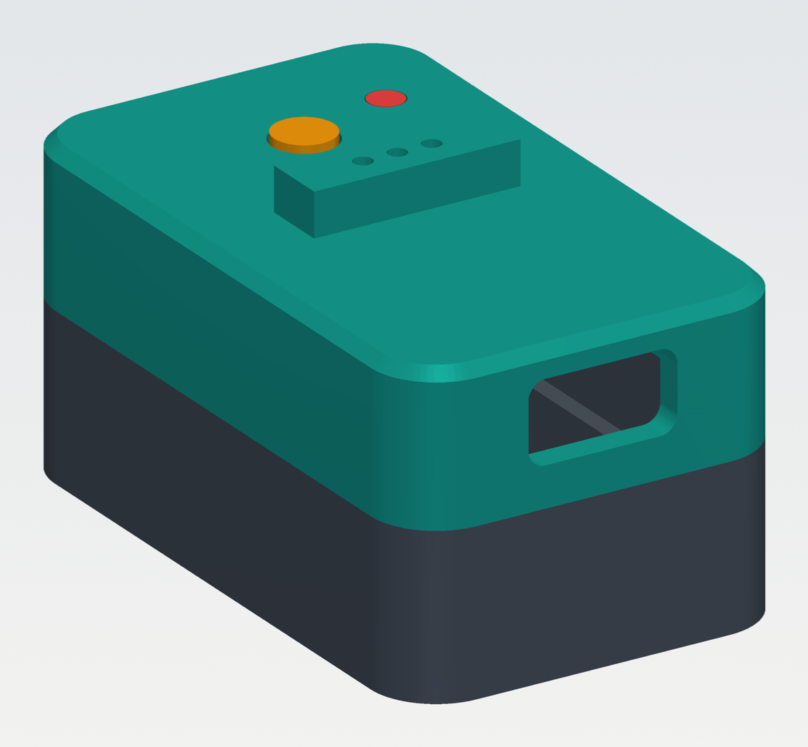
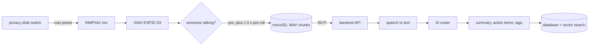
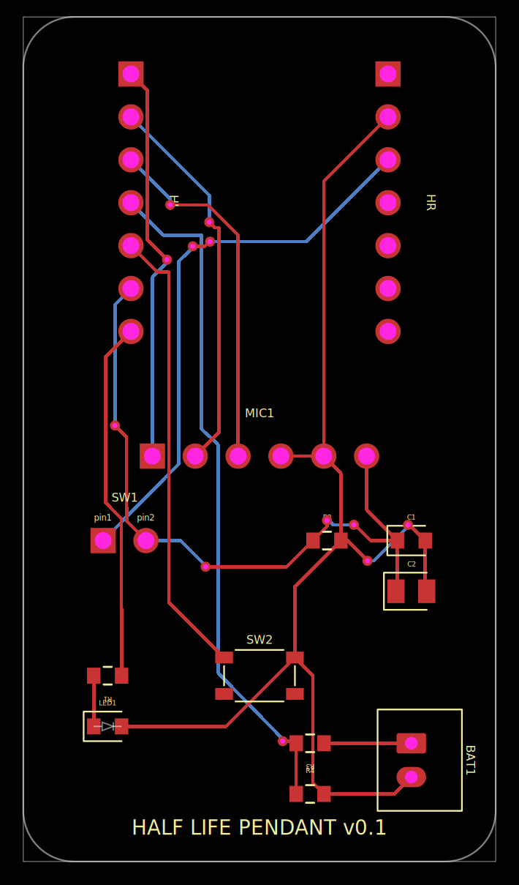
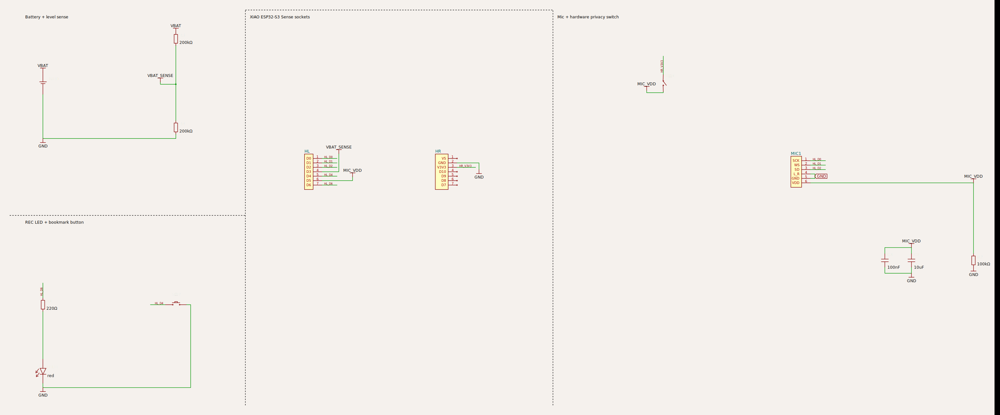
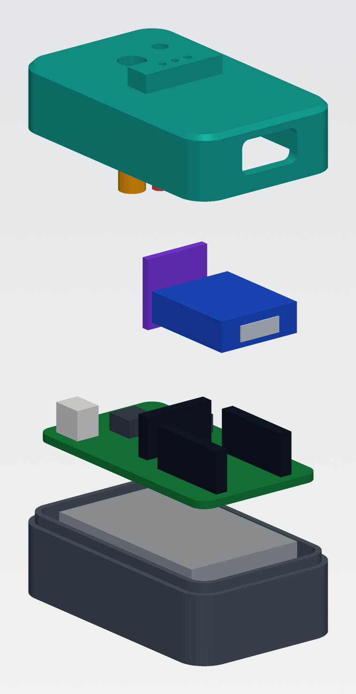
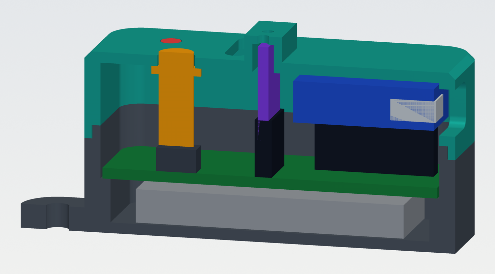
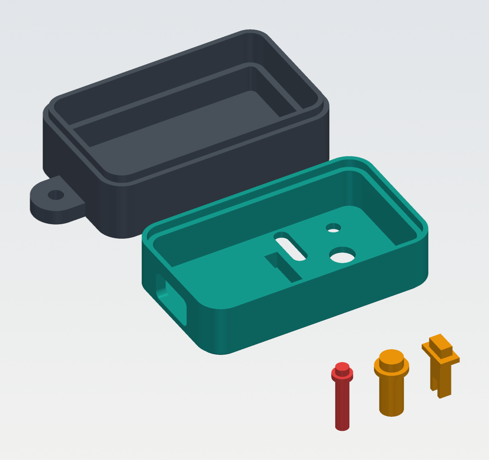
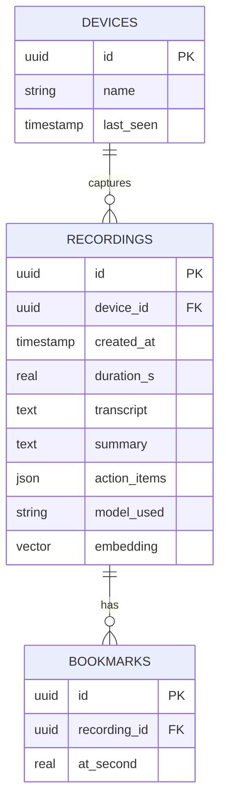

# Half Life Pendant

A small wearable that listens for conversations, records them **only when someone is actually talking**, stores them,
and uses AI to turn them into searchable summaries, so you never lose the thing someone said three weeks ago.

I'm Izyaan and this is my [Hack Club Half Life](https://halflife.hackclub.com) project. A recorder you wear is only okay
if the people around you can trust it, so the whole design starts from one rule: **privacy comes first, and it has to be physical**.

> **Status: design phase.** Everything in this repo is designed and checked in software (PCB design checks, 3D fit check,
> unit tests). Nothing has been manufactured or flashed yet. Each section says exactly what has and hasn't been verified.

## What makes it different

- **A real hardware privacy switch.** The slide switch sits in series with the microphone's power. Switch off and the mic has *no power at all*, so no firmware bug can make it listen. A pin on the microcontroller reads the mic rail, so the firmware always knows the switch state.
- **A recording light you can see.** The red LED is on only while audio is being recorded, and a printed light pipe carries it up to the lid.
- **It never records silence.** A voice detector with an adaptive noise floor wakes the recorder only when someone is talking, which saves battery and storage.
- **It never cuts off the first word.** It keeps 1.5 s of audio from *before* speech was detected and writes it into the file.
- **Bookmarks.** One button press marks "this part matters" inside the current recording.
- **Nothing is lost offline.** Audio goes to a microSD card first, uploads when Wi-Fi is available, and is deleted from the card only after the server confirms.
- **An AI router.** Easy jobs (tags, titles, short summaries) go to a cheap fast model; long conversations go to a stronger one, with fallback if a provider is down.

## How it works

## Hardware

### Carrier PCB

A 28 x 50 mm two-layer board. The XIAO ESP32-S3 Sense plugs into two 7-pin sockets, and the board adds everything the pendant needs around it.

| XIAO pin | GPIO | Job |
|---|---|---|
| D0 | 1 | I2S bit clock to the mic |
| D1 | 2 | I2S word select to the mic |
| D2 | 3 | I2S data from the mic |
| D3 | 4 | battery voltage (2 x 200k divider) |
| D4 | 5 | bookmark button |
| D5 | 6 | reads the mic power rail (privacy switch state) |
| D6 | 43 | red recording LED |

Design details I care about:
- a **100k pulldown** on the mic rail so pin D5 reads a clean LOW when the switch is off (otherwise it would float)
- 100 nF + 10 uF decoupling on the mic supply
- all small passives are 0603 or bigger so the board is hand-solderable
- traces 0.2 mm, vias 0.3 mm hole / 0.6 mm pad, standard 2-layer fab rules

**Files:** KiCad project (`hardware/pcb/half-life-pendant.kicad_*`), schematic PDF, Gerbers + drill (`hardware/pcb/gerbers/`),
pick-and-place, and the [tscircuit](https://tscircuit.com) source the board was generated from. The design passes
tscircuit's netlist, schematic-placement, PCB-placement, build and short-circuit checks.

**Not verified yet:** the PCB has not been opened in KiCad's own DRC or built into a physical board, and the XIAO socket spacing,
switch, button and JST footprints are generic. See [docs/ORDERING.md](docs/ORDERING.md) for the checklist before ordering.

### 3D-printed enclosure

Five parts designed in CadQuery (STEP + STL in `hardware/3d/`): base, lid, button plunger, slider cap and LED light pipe.

- the battery sits in a bay *under* the PCB, the XIAO stack on top, with a USB-C opening in the lid end wall
- the privacy slider and bookmark button are small printed parts that reach down to the real switch and button
- base and lid join with a tongue-and-groove lip, and a lanyard ear sits at the bottom end
- I modelled every real component (PCB, headers, XIAO stack, battery, mic module, switch, button, LED, connector) and **checked every pair for overlap: no printed part collides with anything**

It is chunky (33.4 x 64.9 x 30.8 mm). The mic breakout stands 14 mm tall, which is why the lid has a ridge over it, and the 8.5 mm sockets add height.
v0.2 can fix that with low-profile sockets or by soldering the XIAO straight to the board.

### Bill of materials

Full list in [`bom.csv`](bom.csv): carrier-board parts, plug-in modules (XIAO, INMP441), battery, microSD and the printed parts.

## Firmware

PlatformIO / Arduino project in `firmware/`: voice detection, pre-roll buffer, WAV chunks on the microSD, bookmarks, upload task, battery monitoring and privacy-switch handling.

The voice detector is covered by 10 unit tests that run on a normal PC (no board needed), and they caught a real bug while I was writing it:
in a noisy room the background noise counted as speech, so the detector never adapted to the room. Fixed with a noise floor that drops instantly and rises slowly, plus calibration at boot.

The rest of the firmware is written against the real pin map but **has not been compiled for the ESP32 or run on hardware**. See [firmware/README.md](firmware/README.md).

## Backend

A small FastAPI server (`backend/`) that matches what the firmware uploads, with the AI router, a mock pipeline and the planned database schema. 7 tests pass. Transcription and model calls are stubs until I pick providers.

## Try it without hardware

Open `simulator/index.html` in a browser. It is an interactive model of the pendant's logic: flip the privacy switch, hold the speak button, watch the voice detector with pre-roll and hangover, see recordings queue on the SD card and upload when you switch Wi-Fi on, and watch the battery drain. The numbers in it are design assumptions, not measurements.

## Repo map

| path | what's in it |
|---|---|
| `hardware/pcb/` | KiCad project, schematic PDF, Gerbers, pick-and-place, tscircuit source |
| `hardware/3d/` | CadQuery model, STEP + STL files, render script |
| `bom.csv` | bill of materials |
| `firmware/` | ESP32-S3 firmware + voice detector tests |
| `backend/` | mock server, AI router, schema, tests |
| `simulator/` | interactive browser simulator |
| `docs/` | design notes, ordering guide, images |

## What's next

1. Check footprints against the real parts and order a small batch of boards
2. Compile and flash the firmware, tune the voice detector on real audio
3. Print the case, check the fit, then slim it down for v0.2
4. Pick real transcription and model providers, build the companion app, add encryption and auto-delete

## Credits

Built for Hack Club Half Life. PCB generated with tscircuit, 3D parts with CadQuery.
